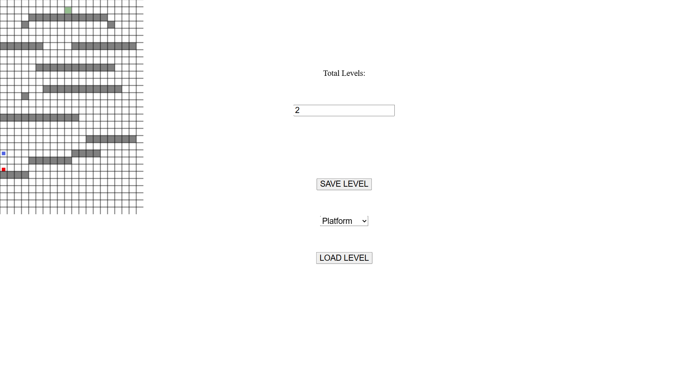

# **SUMMIT**
A game-engine where you can build levels to make it to the top! Made for week 5 of Terra.

## How To Play
https://pokeglitched.github.io/summit/ 

To play your own levels, do the following:
1. Make levels on website
2. Download levels and name them like this
level{NUMBER}.json, where {NUMBER} is an integer, like 1, 2, or 3.
3. Clone Repo
4. Replace levels in level folder with your levels
5. Set amount of levels in your cloned repo webpage
6. Enjoy!

## Screenshots

## About
This project was originally just going to be a developer tool for my game called Summit. However, the game engine ended up taking so much time that I never got to build the game. As such, I'm releaseding the dev tool so that other people can make their own levels and play around with my engine.

This project was made through HTML, CSS, and JS.

I might come back to the project in the future and make it a fully developed game (looking at you, phantom!)

## Controls
WASD, Arrow Keys, Spacebar
Not accessible to mobile (i'm pretty sure, if i checked correctly)